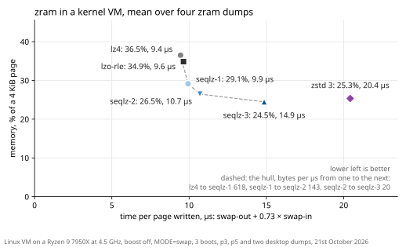
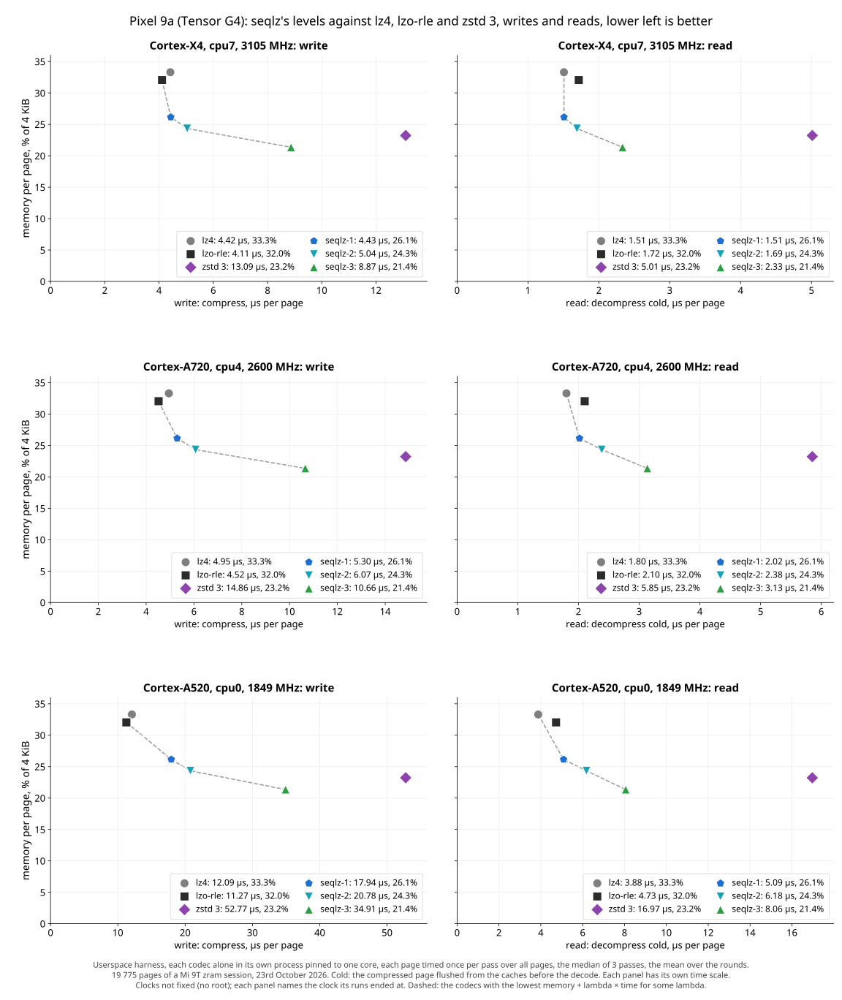

# quetschn

[](https://github.com/martinus/quetschn/actions/workflows/ci.yml)

A compression codec for Linux zram, the compressed swap in RAM that Android phones and many desktops
use. The codec is `seqlz`: one format, one decoder, three levels of the compressor. The goal is `lz4`'s
speed and the size of `zstd` at level 3, zram's default level for it.



The numbers behind the chart: zram as swap in a Linux VM on a Ryzen 9 7950X, the means over four zram
dumps, two of a phone and two of a desktop. Memory is what zsmalloc holds per page, the time per page
written is a swap-out plus 0.73 swap-ins, the reads per write of a phone in daily use; a desktop had
0.34 ([plan.md §1.1](docs/plan.md#11-the-score-memory-against-time-not-bars)):

| codec | memory per page | swap-out | swap-in, cold | time per page written |
| --- | ---: | ---: | ---: | ---: |
| `lz4` | 36.5% | 6.86 µs | 3.59 µs | 9.48 µs |
| `lzo-rle` | 34.9% | 6.64 µs | 4.08 µs | 9.62 µs |
| `zstd` 3 | 25.3% | 15.17 µs | 7.10 µs | 20.35 µs |
| **`seqlz-1`** | **29.1%** | **7.03 µs** | **3.85 µs** | **9.84 µs** |
| **`seqlz-2`** | **26.5%** | **7.64 µs** | **4.18 µs** | **10.69 µs** |
| **`seqlz-3`** | **24.7%** | **11.33 µs** | **4.40 µs** | **14.54 µs** |

- `seqlz-1` stores 20% less than `lz4` for 4% more time per page written.
- `seqlz-2`, zram's default level, stores 27% less for 13% more.
- `seqlz-3` stores 2.4% less than `zstd` 3, in 71% of its time per page written, and a swap-in takes 38%
  less time than with `zstd` 3.
- In these means, from the fastest to the smallest, `lz4`, `seqlz-1`, `seqlz-2` and `seqlz-3` each have
  the lowest score for some exchange rate of bytes against µs; `zstd` 3 stores more than `seqlz-3` in more
  time. `lzo-rle` has none: it stores 4.5% less than `lz4`, but its slower swap-ins make it 1.5% slower
  per page written.

All three swap in 7% to 23% slower than `lz4`, so the case for seqlz is memory, at a cost in time. The
work memory is 8 KiB per CPU for `seqlz-1` and 16 KiB for the other two, against 20 KiB for `lz4`, as
`kmalloc()` hands them out.

## The levels

- **`seqlz-1`**: LZ sequences from a greedy matcher, coded with static Huffman tables that are part of
  the format; the literals as they are.
- **`seqlz-2`**: the same, and the literals coded with the best of 8 fixed literal tables for the page.
- **`seqlz-3`**: the matcher looks one position further for a longer match, a page gets a literal
  table of its own where that saves 16 bytes, and the literals are XORed with the byte 4 or 8 before or
  with the byte at the last match's offset, where that codes them in fewer bits.

One decoder reads all three: the format is the same, and a page does not say which level wrote it.
How they work, and why, is in [seqlz in short](docs/seqlz.md) and in the book below.

## On a phone

A Xiaomi Mi 9T, zram in the phone's own kernel (Linux 4.14, so no `lzo-rle`), 19 775 pages from a
session on the phone, the time per page written as above, write + 0.73 × cold read, on 15th October
2026:

| codec | memory per page | big core, A76 | little core, A55 |
| --- | ---: | ---: | ---: |
| `lz4` | 33.3% | 14.6 µs | 42.8 µs |
| `zstd` 3 | 23.2% | 52.0 µs | 164.6 µs |
| **`seqlz-1`** | **26.1%** | **15.8 µs** | **50.3 µs** |
| **`seqlz-2`** | **24.3%** | **17.6 µs** | **55.9 µs** |
| **`seqlz-3`** | **23.2%** | **22.2 µs** | **67.6 µs** |

On the phone `seqlz-3` takes less than half of `zstd` 3's time for the same memory. The gap to `lz4` is
larger than on the PC, most of all on the little core, and cold reads there cost `seqlz-2` 34% more
than `lz4`. Chart and details:
[seqlz.md](docs/seqlz.md#level-3-zstd-3s-memory-in-less-than-half-its-time). This table's `seqlz-3` is
the level of 15th October. Since 21st October it XORs its literals: on the same pages, in userspace on
the Mi 9T, it stores 873.1 instead of 926.6 bytes per page, for 3.5 µs more per page written on the A76
and 7.6 µs on the A55
([explored-designs.md](docs/explored-designs.md#level-3-xors-its-literals-with-an-earlier-byte-of-the-page-38-fewer-bytes-than-seqlz-3-of-15-october-kept)).

On a current phone, a Pixel 9a with Google's Tensor G4, the codecs in userspace on each of its three
kinds of core, the same pages, each page timed once per pass over all of them, as a swap-in sees it:



On the big cores `seqlz-1` writes and reads about as fast as `lz4`, 5.49 against 5.56 µs per page
written on the X4, and `seqlz-2` takes 12% and 19% more time than `lz4` on the X4 and the A720. The
little A520 is where seqlz costs: `seqlz-2` takes 1.7 times `lz4`'s time per page written there, and a
cold read 5.86 instead of 3.70 µs. `seqlz-3`, the level before its XOR of 21st October, stores as
little as `zstd` 3 in about half its time on every core. These are the codec's times in a harness, not zram in the phone's kernel, with clocks that could
not be fixed without root; they stayed at their maximum in every run
([explored-designs.md](docs/explored-designs.md#a-current-phone-the-pixel-9a-seqlz-1-as-fast-as-lz4-on-the-big-cores-seqlz-1-and-seqlz-2-14-and-17-times-lz4s-time-on-the-little-one)).

## Where it stands

As of 16th October 2026. The details, and what comes next, are in [the plan, §9](docs/plan.md#9-where-the-project-stands-and-the-next-actions).

- [x] Benchmark harness, page collectors, zram dumps of a desktop and of a phone
- [x] The codec, three levels of [`seqlz`](docs/seqlz.md), and every alternative that was measured
- [x] [The format](docs/format.md), two reference decoders written from it, fuzzing, the worst case measured
- [x] Measured in a kernel: a VM on x86-64, and the Mi 9T's own kernel on arm64
- [x] The tables on pages they were not trained on, Chrome, Firefox, Android 13 and 15, the phone 12
  days later: tables of their own would gain 1.2% at `seqlz-2` and 0.7% at `seqlz-3`
  ([explored-designs.md](docs/explored-designs.md#the-tables-on-five-new-page-populations-tables-of-their-own-12-smaller-at-level-2-07-at-level-3-kept-as-they-are))
- [x] Ask the zram maintainers whether they want a new backend at all, and in which form: [sent](https://lore.kernel.org/linux-mm/CAAFOosa2WLf--T17cujJu5CUsN12NNjgTitOvno2LY7jAr1gfw@mail.gmail.com/), no answer yet
- [x] 16 KiB pages: tables trained on the pages of the Android 17 emulator
- [ ] 16 KiB pages: work memory within `lz4`'s, and a phone with 16 KiB pages
- [x] The kernel port: `lib/` and a zram backend, swap thrash under KASAN, the zram selftests

> [!WARNING]
> Nobody uses seqlz yet, and the format can still change. Don't store pages with it that have to
> decode in a later version.

## Build and test

You need CMake 3.25, Ninja, and a C and C++20 compiler. doctest is fetched by CMake.

```sh
cmake -S . -B build -G Ninja -DQUETSCHN_WERROR=ON
cmake --build build
./build/quetschn_test
```

That builds the codec, the tests and the tools that need no kernel. The benchmarks against zram's own
codecs need a Linux source tree, see [Measuring](docs/measuring.md). How to change something is in
[CONTRIBUTING.md](CONTRIBUTING.md).

## What is where

| directory | what it holds |
| --- | --- |
| [`src/`](src) | the codec, freestanding C: encoder, decoder, matcher, and the trained tables |
| [`bench/`](bench) | the benchmark harness: per-page timing, zsmalloc's cost model, table training, zram's codecs built in userspace |
| [`test/`](test) | the doctest unit tests, `quetschn_test` |
| [`fuzz/`](fuzz) | libFuzzer and AFL++ targets: the decoder, the roundtrip, the decoder against the reference decoder |
| [`tools/`](tools) | page collectors, reference decoders, the kernel VM, the phone tests, plots, see [`tools/README.md`](tools/README.md) |
| [`docs/`](docs) | how seqlz works, the format, the plan, how to measure, and every design measured, see [`docs/README.md`](docs/README.md) |
| [`cmake/`](cmake) | builds zram's `lz4`, `lzo` and `zstd` from a kernel tree with the kernel's flags |

## Documentation

| document | read it if you want to |
| --- | --- |
| [seqlz in short](docs/seqlz.md) | see the result against zram's codecs and the choices with their numbers; the book below has the details |
| [seqlz, line by line](https://martin.ankerl.com/quetschn/) | read every line of `src/` explained, with the decoder and the matcher step by step on real pages; the book's sources are in [`docs/book/`](docs/book) |
| [The seqlz format](docs/format.md) | write a decoder, or check one |
| [Measuring](docs/measuring.md) | benchmark, in a kernel VM, in userspace or on a phone, and collect pages |
| [The plan](docs/plan.md) | know the goal, how designs are scored, what zram needs, and where the project stands |
| [Explored designs](docs/explored-designs.md) | know what was tried, with the numbers, before you try it again |

## License

quetschn is dual licensed under **`MIT OR GPL-2.0-only`**, at your option:
[LICENSE-MIT](LICENSE-MIT), [LICENSE-GPL-2.0](LICENSE-GPL-2.0). The GPL-2.0-only option is there so
the codec can go into the Linux kernel, the MIT option so that userspace and non-GPL projects can use
it too. zstd does the same.

The `quetschn-bench-*` binaries are an exception: they link GPL-2.0-only kernel code, so they are
GPL-2.0 works. They are for measuring and not for distribution.
