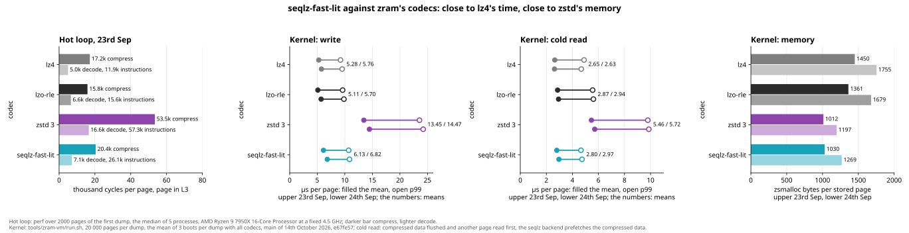
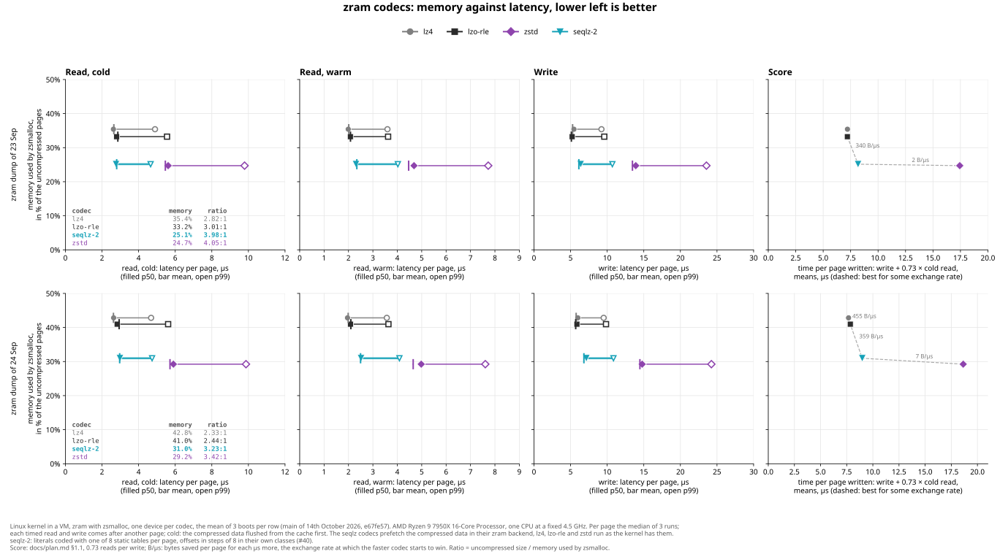
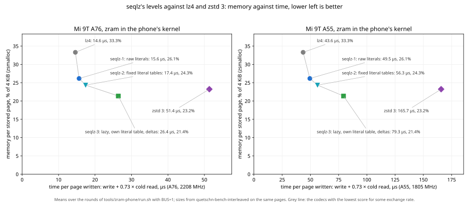
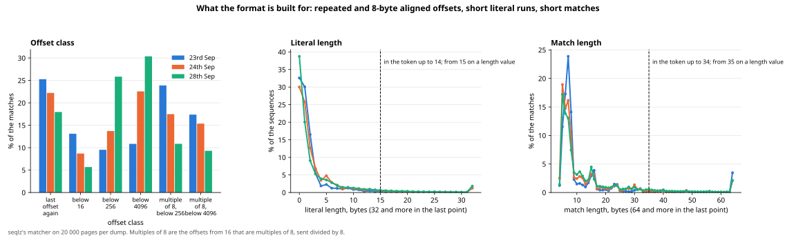

# seqlz in short: the result, and the choices

*How to store a memory page almost as small as `zstd` does, almost as fast as `lz4` does.*

> [!NOTE]
> **In short.** zram keeps swapped-out memory pages compressed in RAM. On the pages my desktop swapped
> there, `seqlz-2` stores a page in **24% fewer bytes** than `lzo-rle`, zram's default, and
> 29% and 28% fewer than `lz4`, the fastest common choice. It takes **16% and 18% more time** than
> `lz4` to write a page and 6% and 13% more to read one. `zstd`, which compresses best, stores a page
> in 2% and 6% fewer bytes than `seqlz-2`, but takes 2.2 and 2.1 times the time to write and
> 1.9 times the time to read. Each pair of numbers is for two sets of pages, see below.

This page is the overview: the result, what is not known yet, and the choices with their numbers. The
book [seqlz, line by line](https://martin.ankerl.com/quetschn/) explains every line of `src/`, with
step-throughs of the real decoder and matcher; read it to learn how `seqlz` works in detail. The exact
bytes of a compressed page, for writing a decoder, are in [format.md](format.md); the history of every
idea, also of the ones that failed, is in [explored-designs.md](explored-designs.md).

How to read the numbers:

* **Three levels, one format.** `seqlz-1` stores the leftover bytes of a page as they are,
  `seqlz-2` also compresses them with one of 8 fixed tables, `seqlz-3` searches one position further
  for matches, can give a page a table of its own and stores the leftover bytes as deltas to earlier
  bytes of the page first, see [Level 3](#level-3-zstd-3s-memory-in-less-than-half-its-time).
  All write the same format, and one decoder reads all of them. Numbers are for `seqlz-2` unless they
  say otherwise.
* **Dumps.** A dump is a copy of all pages that were in zram on my desktop at one moment. The numbers
  come from two of them: the first from 23rd September 2026, the second from 24th September. Two
  numbers like "1030 / 1269" or "29% and 28%" are the first and the second dump.
* **Stored size and work memory.** The stored size is how many bytes zram spends on one compressed
  page, rounded up to a size class of zsmalloc, zram's allocator. The work memory is what the codec
  needs for its own buffers, once per CPU. "Smaller" on this page means the stored size.
* **Points.** A point is 1% of the 4096 bytes of a page, 41 bytes.
* **Time per page written** is the mean time to write a page plus 0.73 times the mean time to read
  one back cold, with its compressed bytes in no CPU cache: my phone, in daily use, read 0.73 pages back
  from zram for every page it wrote, my desktop 0.34 ([plan.md](plan.md#11-the-score-memory-against-time-not-bars),
  [the book](https://martin.ankerl.com/quetschn/#ch-zram--score)). How many bytes one µs per page is
  worth to you, an exchange rate, decides which codec is the best choice.
* **When it was measured.** [The result](#the-result-lz4s-time-zstds-size-almost) is from 14th
  October 2026, with the code and the tables of that day. The tables are trained on three sessions of a
  phone under memory pressure, on pages that programs had in RAM on a desktop and on a third zram dump
  of that desktop, not on the two dumps measured here.

## The result: lz4's time, zstd's size, almost

Measured in the real kernel, in a virtual machine, on 20 000 pages of each dump, on one desktop CPU
core, means over the pages, first dump / second dump:

| codec | stored bytes per page | write, µs | cold read, µs | time per page written, µs |
| --- | --- | --- | --- | --- |
| `lz4` (fastest) | 1450 / 1755 | 5.28 / 5.76 | 2.65 / 2.63 | 7.21 / 7.68 |
| `lzo-rle` (zram's default) | 1361 / 1679 | 5.11 / 5.70 | 2.87 / 2.94 | 7.21 / 7.85 |
| **`seqlz-2`** | **1030 / 1269** | **6.13 / 6.82** | **2.80 / 2.97** | **8.17 / 8.99** |
| `zstd` 3 (smallest) | 1012 / 1197 | 13.45 / 14.47 | 5.46 / 5.72 | 17.44 / 18.65 |

Compare the bold row with `lz4` and `zstd`: its size is close to `zstd`'s, its time close to
`lz4`'s. In the chart above, the three panels on the right have the numbers of the table, write,
cold read and stored bytes, each with the first dump above and the second below. The first panel,
"Hot loop", is the codec alone, outside the kernel, in a loop over pages that are in the CPU's
cache, in thousands of CPU cycles (ticks of the CPU's clock) per page: the darker bar compressing,
the lighter one decoding.

> [!NOTE]
> **How the times are measured, and what p99 is.** The VM is [`tools/zram-vm/run.sh`](../tools/zram-vm/run.sh),
> all codecs in each boot, `seqlz-1` too, 3 boots per dump and the means over them, one CPU of a
> Ryzen 9 7950X fixed at 4.5 GHz. A program in
> the VM writes each page to zram with `pwrite` and reads it back with `pread`, and times each call.
> So a time is the whole system call, zram and zsmalloc included, not only the codec. Each page is
> timed 3 times and its median counts. For a cold read, the compressed page is flushed from the CPU
> cache first. The **mean** is the average over the 20 000 pages, the **median** or p50 the time half
> of them stay below. For **p99** the 20 000 times are sorted: p99 is the one at position 19 800, so
> 99% of the pages are done faster and the slowest 200 take longer. The mean says how much time all
> pages cost together; p99 shows whether some pages are much slower than the rest, and a program
> that waits for such a page feels it.

The slowest pages, p99, and the work memory

At p99 `seqlz-2` reads cold pages in 4.66 and 4.74 µs, faster than `lzo-rle` (5.55 and 5.61);
`lz4` needs 4.90 and 4.68. It writes in 10.7 and 10.9 µs, where `lz4` needs 9.2 and 9.5 and `zstd`
23.6 and 24.2. Its work memory is 8 KiB per CPU, one `kmalloc()` for the matcher's table of
8192 bytes and a buffer of 4112 bytes the decoder decodes literals into, which are never in use at the
same time; 16 KiB once zram gives compression and decompression contexts of their own. `lz4` takes its
16 416 bytes of work space from `vmalloc()`, which are 5 pages, 20 KiB, and a small struct. Two things
are not work memory: the buffer the compressed page is written into is zram's, two pages per CPU for
every codec, and the tables for encoder and decoder, 43 280 bytes, are built from the fixed code
lengths and shared by all CPUs: once when the kernel starts in the kernel's copy
(`tools/kernel-port/`), once per zram device in the experiments of `tools/zram-vm/` and in the harness.

No codec is better on both counts: nothing stores pages smaller than `seqlz-2` without taking
twice its time, and none of zram's codecs is faster without taking at least 32% more bytes. `zstd`
saves 2 and 7 bytes per page for each µs more than `seqlz-2`. `seqlz-1`, the same format
with raw literals, was measured in the same boots, 1118 / 1462 bytes and 7.67 / 8.14 µs per page
written. `seqlz-2` saves 175 and 229 bytes per page for each µs more than `seqlz-1`, and
`seqlz-1` about 520 and 630 for each µs more than the faster of `lz4` and `lzo-rle`. So if a µs is
worth less than 7 bytes to you, `zstd`'s smaller pages pay for its extra time, at least on the second
dump. From there up to 175 bytes, `seqlz-2` is the best choice on both dumps, from 229 to about 520
bytes `seqlz-1`, and above about 630 bytes `lz4` or `lzo-rle`. The chart below shows it, without
`seqlz-1`.

How to read this chart: one row per dump. In each panel a codec's stored size is up and down, its
time left and right, so lower left is better; the panels are the time to read cold, to read warm,
to write, and the time per page written, the "Score". The markers are the median (filled), the mean
(bar) and p99 (open). In the Score panel the dashed line joins the codecs that are the best choice
for some exchange rate, and "B/µs" is the bytes saved per µs between two of them. The table in each
row has the stored size in % of the page and the ratio, e.g. 3.94:1: the page's size divided by its
stored size.

## How it works, in short

**Literals and matches.** Like `lz4` and `zstd`, `seqlz` cuts a page into sequences. A sequence is
some literals, bytes stored as they are, and then a match: copy `ml` bytes from `offset` bytes back in
the page. Memory pages are full of such repeats, because programs store arrays of similar things. The
codecs differ in how they write the numbers of a sequence down: `lz4` in whole bytes, `zstd` and
`seqlz` in bits, with codes that give the frequent values the short ones
([compression from zero](https://martin.ankerl.com/quetschn/#ch-compression),
[one sequence in each format](https://martin.ankerl.com/quetschn/#ch-compression--formats)).

**The page.** A compressed page has a small header, then all literals of the page in one block, then
the sequences as one stream of bits, the bitstream. There is no count of the sequences: the last one
is the one whose literals fill the page
([two layouts](https://martin.ankerl.com/quetschn/#ch-format--layout),
[how a page ends](https://martin.ankerl.com/quetschn/#ch-format--end)).

**The token.** Each sequence starts with a token, one number for the literal count `ll`, the match
length `ml - 4` and the offset class. The token gets a Huffman code from a fixed table, so a frequent
sequence takes only a few bits. The rare tokens share one code, the escape, which the token's number
follows in plain bits
([one sequence: the token](https://martin.ankerl.com/quetschn/#ch-format--token),
[the escape and the caps](https://martin.ankerl.com/quetschn/#ch-header--escape)).

**The offset classes.** The class in the token says how the offset is stored. Class 0 is the repeat
offset, the offset of the match before, and takes no bits. Classes 1 to 3 store a short, a medium and
a long offset in plain bits. Memory is full of 8-byte pointers and fields, so classes 4 and 5 store an
offset that is a multiple of 8 divided by 8, in 3 bits less
([offset classes](https://martin.ankerl.com/quetschn/#ch-format--offsets)).

**The length values.** Short literal runs and short matches fit into the token. For a longer one the
rest follows the offset bits as a length value: a code from one of two more fixed tables and some plain
bits ([length values](https://martin.ankerl.com/quetschn/#ch-format--length-values)).

**The literals, in 8 streams.** `seqlz-2` codes the literals of a page with one of 8 fixed
literal tables, the one that takes the fewest bits for this page, and only where that saves 1/16 of
them; otherwise they stay as they are. The coded literals are dealt out to 8 streams, literal `k` to
stream `k mod 8`, so that the decoder can decode 8 of them side by side
([coding the literals](https://martin.ankerl.com/quetschn/#ch-literals-enc),
[decoding them](https://martin.ankerl.com/quetschn/#ch-literals-dec)).

**Fixed tables.** All tables are trained once, on many pages, and are part of the format. At levels 1
and 2 a page carries no table, and the decoder builds nothing from it. A table of the page's own fits
the page better, but it has to be stored in the page and built for every page: only level 3 does that,
see [Level 3](#level-3-zstd-3s-memory-in-less-than-half-its-time)
([where the code lengths come from](https://martin.ankerl.com/quetschn/#ch-codes--lengths)).

**The encoder.** The matcher is greedy. At every position of the page it checks two candidates, the
repeat offset and the last position whose next 5 bytes had the same hash, from a table of 8 KiB that is
cleared for each page. It takes the first match it finds, counts how far it goes forwards, and hands the
sequence to the encoder right away. The encoder writes the literals from the front of zram's output
buffer and the bits from its back, and codes the literals at the end
([the matcher](https://martin.ankerl.com/quetschn/#ch-matcher),
[the encoder](https://martin.ankerl.com/quetschn/#ch-encoder)).

**The decoder.** It decodes coded literals first, 8 streams side by side, into a buffer. Then, per
sequence, it looks up the next 11 bits in the token table, whose entry has `ll`, `ml` and how to cut
the offset out of the bits after the token, takes the offset without a branch, and copies the literals
and the match. Every length and offset is checked against the page before it is used, so a damaged page
is rejected, and fuzz tests hold the decoder against a second one written from [format.md](format.md)
alone ([seqlz_decode()](https://martin.ankerl.com/quetschn/#ch-decode),
[one page through every function](https://martin.ankerl.com/quetschn/#ch-trace)).

**Why it is nearly as fast as `lz4`.** The decoder runs more instructions per page than `lz4`'s, but
more of them are independent of each other, so the CPU runs more of them per cycle. There is one table
lookup per sequence, because the token holds all three numbers. The tables are small enough for the L1
cache. All codes are complete, so the decoder never checks for bits that are no code. The common short
sequence needs no loop and no length value, the literals are 8 chains of work instead of one, and the
compressed page can be prefetched before decoding starts
([what makes code slow on a CPU](https://martin.ankerl.com/quetschn/#ch-cpu),
[the decoder's choices](https://martin.ankerl.com/quetschn/#ch-decisions--decoder)).

**Why `zstd` still stores pages smaller.** `zstd` 3 searches more for matches, codes a page's literals
with a table built for that page, and codes `ll`, `ml` and the offset with tables it can fit to the
data. Each of these costs time that zram's writes and reads cannot spend
([where zstd still wins](https://martin.ankerl.com/quetschn/#ch-decisions--zstd)). Level 3 does the
first two in part, below.

## Level 3: zstd 3's memory in less than half its time

Level 3 is level 2 with two more steps, and since 21st October a third, below. The matcher looks one position further before it takes a match
shorter than 20 bytes, and extends a match backwards over the literals before it. And a page with 512
literals or more gets a literal table of its own where that and the table's description save 16 bytes
against the best of the 8 fixed tables. The description is the code length of each byte, in the order of
the bytes, about 50 to 75 bytes; the decoder builds the table in the page it decodes into, so it needs no
more memory ([format.md](format.md#a-pages-own-literal-table)).

Since 21st October 2026 level 3 also stores each literal as its delta to an earlier byte of the page,
the literal minus that byte, before it codes them: the byte 4 or 8 before, inside the literals of one
sequence, or the byte as far back as the last match's offset, one choice per page, the one whose deltas
the fixed tables code in the fewest bits. Pages are full of 4- and 8-byte fields whose high bytes
repeat, or whose values grow by a little from one record to the next, and a literal after a match often
differs only a little from the byte the match would have copied. On the ten 20 000-page samples level 3
stores 4.6% less with it, 873.6 instead of 915.6 bytes per page; on the Mi 9T's big core a write takes
about 4 µs more and a read 0.5 µs more, in userspace. A XOR with the same bytes, the first form, stored
881.0 ([explored-designs.md](explored-designs.md#level-3-stores-its-literals-as-deltas-not-xors-084-fewer-bytes-than-the-xor-kept),
[format.md](format.md#literals-as-deltas)). The numbers below are from 15th October, before it.

On the Mi 9T, zram in the phone's own kernel, the 19 775 pages of a phone session that the tables were
not trained on, 15th October 2026, time per page written as above:

| codec | bytes per page | big core, A76 | little core, A55 |
| --- | ---: | ---: | ---: |
| `lz4` | 1364 | 14.6 µs | 42.8 µs |
| `seqlz-1` | 1071 | 15.8 µs | 50.3 µs |
| `seqlz-2` | 997 | 17.6 µs | 55.9 µs |
| `seqlz-3` | 952 | 22.2 µs | 67.6 µs |
| `zstd` 3 | 951 | 52.0 µs | 164.6 µs |

So `seqlz-3` stores a page in as much memory as `zstd` 3, 0.6 bytes more, in 43% of its time on the big
core and 41% on the little one, and in 4.5% less memory than `seqlz-2` for 26% and 21% more time. On ten
dumps of desktops and phones it stores 0.30% more than `zstd` 3 on average, between 1.6% less and 3.5%
more. Its reads are 0.4 and 1.1 µs slower than `seqlz-2`'s warm, 0.5 and 2.9 µs cold, and its work memory
is the same, 16 KiB per CPU
([explored-designs.md](explored-designs.md#level-3-a-lazy-matcher-and-a-literal-table-of-the-pages-own-zstd-3s-memory-in-less-than-half-its-time-on-the-phone-kept)).
In the kernel VM on 21st October, the mean over four zram dumps, level 3 stores 24.5% of a page in 14.86
µs per page written with its deltas, `zstd` 3 25.3% in 20.42 µs ([README](../README.md)); without them,
in another run that day, 25.4% in 12.96 µs.

## What is not known yet

> [!WARNING]
> * **One desktop, one phone.** The numbers in this document are from two zram dumps of one desktop;
>   the tables are trained on other pages of that desktop, the ones programs had in RAM, and on one
>   zram dump of a phone.
> * **arm64 on one phone.** The times here are from x86-64. On the small core of a Mi 9T phone, a
>   Cortex-A55, in the phone's own kernel, on the pages of the first dump, a cold read takes 59 µs for
>   `seqlz-1` and 61 µs for `seqlz-2` at the median, against 52 µs for `lz4`: 12% and 17% more.
>   On the big core it is 9.3 and 9.4 µs against 7.2. On the little core `seqlz-2` is the best
>   choice only up to 12 bytes per µs, `seqlz-1` up to 24
>   ([explored-designs.md](explored-designs.md#the-numbers-again-with-the-bit-order-and-the-token-tables-prefetch-cold-reads-on-the-a76-3-µs-faster)).
>   In a test that switches between 25 apps, with the same RAM given to zram, launches were not
>   slower, and because `seqlz` stores pages smaller every app stayed in memory, where `lz4` lost some
>   ([Apps on the phone](explored-designs.md#apps-on-the-phone-with-the-same-ram-no-cold-launch-in-6-runs-of-seqlz-54-in-3-runs-of-lz4)).
> * **16 KiB pages.** Android is moving to them, and there `seqlz-2` needs 32 784 bytes of
>   work memory per CPU, twice `lz4`'s, a cost in
>   [the score](plan.md#11-the-score-memory-against-time-not-bars). A way around it is built and
>   measured, but not kept, see [explored-designs.md](explored-designs.md). Their
>   tables are trained on a zram dump of the Android 17 emulator with 16 KiB pages and measured on a
>   second one ([explored-designs.md](explored-designs.md#android-17-in-the-emulator-the-4-kib-tables-fit-the-16-kib-ones-trained-again-26-smaller)); there is
>   no phone with 16 KiB pages yet, and the format for 16 KiB pages is not fixed
>   ([format.md](format.md#status)).
> * **Writes at p99** take 1.21 and 1.19 times `lz4`'s time.

## The choices, with their numbers

Each choice was measured against the alternative in the second column; the numbers are from
[explored-designs.md](explored-designs.md), 4 KiB pages, two numbers for the first and the second
dump. Cycle counts are from the time of each change, so rows are not comparable with each other.

<b>The format</b>

| choice | instead of | gain | price |
| --- | --- | --- | --- |
| `ll`, `ml` and the offset class in one token | a symbol each | 22% fewer decode cycles, and smaller pages | |
| the offset class in the token, plain offset bits after it | the offset's size Huffman coded on its own | 7% fewer decode cycles, 8168 instead of 8758 per page: one table lookup per sequence | 0.4 points |
| token codes of at most 11 bits, a table of 2048 entries | 12 bits, 4096 entries | the slowest 1% of cold reads take 4350 instead of 5070 ns: the smaller table stays in L1, measured with entries of 2 bytes | none measured in size |
| the bitstream read highest bit first | lowest bit first | a code's entries are one range of the token table, so a page needs 42 instead of 55 of its 128 cache lines, on every CPU without reversing bits | none, the same bytes |
| token codes of at most 11 bits | 10 bits, 1024 entries, half the lines to prefetch | pages 0.2% to 0.4% smaller, swap-ins 2% to 4% faster in the kernel VM ([explored-designs.md](explored-designs.md#the-token-table-in-10-bits-again-the-a55s-cold-reads-13-µs-faster-x86-64-2-to-4-slower-not-kept)) | the A55 reads cold pages 1.3 µs slower |
| rare tokens escaped | a code for every token | needed: 11 bits have room for 2048 codes, there are 3072 tokens | 16 bits for a rare token |
| match lengths up to 34 in the token | up to 18 | a length value after 8.5% of the matches instead of 18.7%, and fewer mispredicted branches: 9180 instead of 9400 decode cycles | |
| one repeat offset | three, as in `zstd` | 17% fewer decode cycles | 0.2 points: the other two were 11% of the matches |
| two classes for offsets that are multiples of 8 | only plain offsets | 24 and 2 bytes less per page in the kernel | 0.2 µs more time per page written |
| only complete Huffman codes | checks for invalid codes | 6% fewer instructions in the decoder | |
| trained codes for the length values | the symbol in 5 plain bits | 3.2 and 2.8 bytes less per page | two more tables in the format |

<b>The literals</b>

| choice | instead of | gain | price |
| --- | --- | --- | --- |
| fixed tables | a table built for each page | 13% and 15% faster writes | pages 0.3% and 4.6% larger, 2.7 and 60.6 bytes |
| one of 8 literal tables per page | one table for all pages | pages 10.2% and 12.5% smaller than without coded literals, where one table gives 7.3% and 6.3% | 8 tables of 2 KiB to decode with |
| literals in 8 streams | 4 streams | 4% fewer decode cycles, 8676 instead of 9070 per page | 8 more bytes of header, with sizes of 2 bytes: 0.1 to 0.2 points |
| stream sizes in as many bits as the largest needs | 2 bytes each | 5.2 and 5.5 bytes less per page, 0.13 points, no time measured | 5 bits of byte 2 |
| literals coded only if that saves 1/16 of them | coded whenever it saves anything | no decoding of literals on pages where it saves only a few bytes | less than 0.1 points |

<b>The matcher</b>

| choice | instead of | gain | price |
| --- | --- | --- | --- |
| a hash of 5 bytes | 4 bytes | 5% fewer compress cycles, and the slowest 1% of writes 10% faster in the kernel, with older tables | none with the tables of 5th October: 4 bytes make pages 18 to 35 bytes larger |
| the repeat offset checked at every position | only the table of positions | 0.5 points smaller | |
| the table of positions cleared for each page | checking each entry's age | compressing 7% faster | |
| every position tried | `lz4`'s way of skipping ahead faster and faster when it finds no match | writes 1% to 3% faster in the kernel | pages zram stores uncompressed take 2.3 µs longer |

<b>The decoder</b>

| choice | instead of | gain | price |
| --- | --- | --- | --- |
| one loop, the token table prefetched on every core | a loop for in-order cores, the prefetch only there | no list of cores in the kernel, half the decoder's code; a Cortex-A55 needs the prefetch, 14.5 µs slower cold without any, and on a Cortex-A76 it did not show as slower on 10th October | a Cortex-A55 reads a warm page up to 0.3 µs slower with the out-of-order loop |

<b>Tried and not kept</b>

A token table chosen by the offset class before it (3 to 12 bytes per page for three times the
tables), the literals coded inside the matcher's loop (more cycles than the pass after it), decoding
the literals into the output page to save the work memory (slower cold reads), `lz4`'s format from a
better compressor, other ways to compress memory pages and short strings (the word model of WKdm,
BΔI, a byte shuffle, FSST and Tunstall codes for the literals), recompressing idle pages, and on the
phone a token table of 10 bits (4.8 bytes per page for 2 µs of cold reads on the A55 only), literal
tables of 9 bits, 4 literal streams, other hash sizes and fixed copies of 32 and 40 bytes. Why each
of them failed is in [explored-designs.md](explored-designs.md).

## The sequences of 30th September

These counts were measured with `seqlz`'s own matcher by 30th September 2026, with the tables and the
offset classes of that time: class 1 the offsets below 16 in 4 bits, class 5 the multiples of 8 from
256 on in 9 bits. The book has the counts with today's classes.

The chart shows how often each offset class, each literal length and each match length occurs, on
20 000 pages of each of three desktop dumps, of 23rd, 24th and 28th September, with lines where the
token's caps are:

* **18% to 25%** of the matches have the repeat offset: 0 bits.
* **20% to 41%** are multiples of 8: 5 or 9 bits instead of 8 or 12.

On the first and the second dump, 29% and 36% of the matches with a class 3 offset are 5 bytes long,
against 12% and 19% of all matches, so the class and the lengths go together. Each token without a
code of its own is rare, but together they are 14 to 38 of about 200 sequences per page on the
desktop dumps of that time, and each of them takes the escape.
